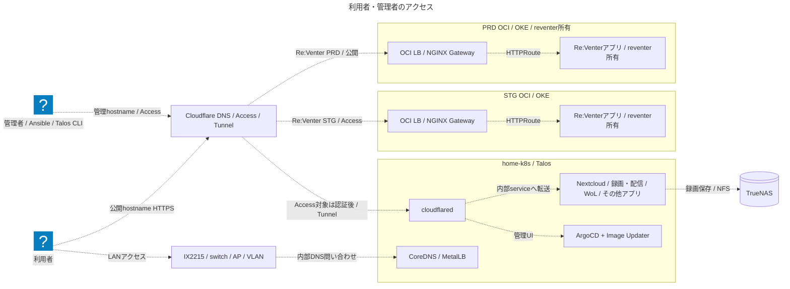
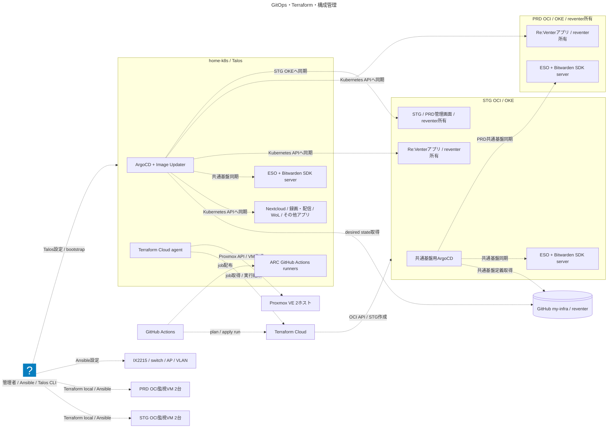
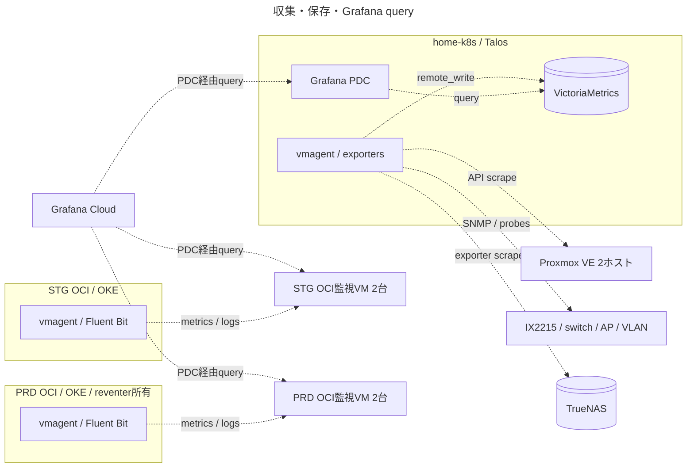
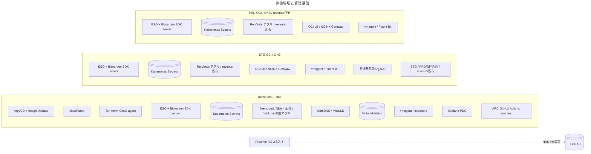
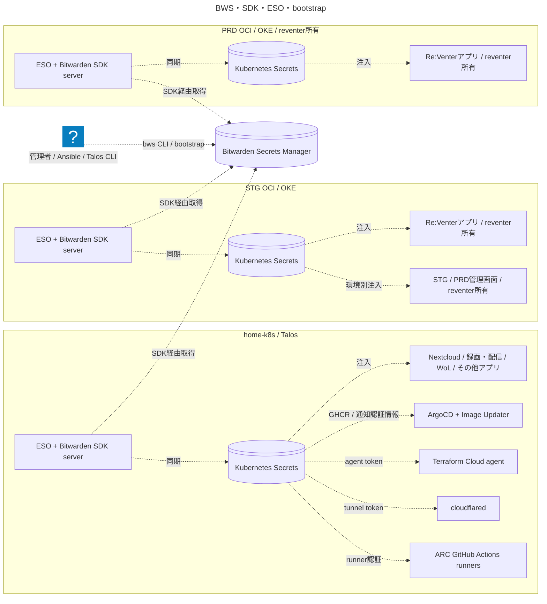

# アーキテクチャモデル

LikeC4の試作。`model.c4`にリソースと関係を一度だけ定義し、`views.c4`で目的ごとの図を選ぶ。入れ子の枠は稼働・収容場所を表す。配置図では枠と収容関係を使い、通常の通信矢印を表示しない。図の矢印は論理的な要求・操作の向きで、TCP接続を開始する向きではない。TunnelやPDCは外向きに接続する。

| 関係 | 意味 |
| --- | --- |
| access / 青・実線 | 利用者・管理者の要求、実行時のサービス通信 |
| deploy / 橙・破線 | Git取得、image配布、API操作、構成の同期 |
| secret / 赤・点線 | 秘密情報の取得・注入。値は記載しない |
| observe / 緑・点線 | scrape、ログ・メトリクス送信、query |
| placement / 灰・破線 | 稼働場所・収容関係。通信を意味しない |

色・線種はLikeC4の対話ビューで確認する。Mermaid出力ではLikeC4の線種・色が保持されないため、READMEではviewの目的と矢印の操作名で意味を区別する。

## 編集・確認

Node.js 24を使用する。

```bash
cd docs/architecture
npm ci
npm run dev       # 対話的に各viewを閲覧
npm run validate # DSL・参照・layoutを検証
npm run generate # MermaidとREADMEの図を再生成
npm run check    # 生成物の更新漏れを検査
npm run build    # dist/ に対話的な静的サイトを生成
```

正本は `.c4`。`generated/*.mmd`、このREADMEの図、ルートREADMEの図は生成物で、直接編集しない。配置や関係を変えたらモデルを更新し、既存viewに出す必要があるかを確認する。新しい関係種別は `specification.c4` に追加する。各viewは関係のkindも絞るため、同じリソースを含めても異なる意味の線が混入しない。

[CIテンプレート](architecture-workflow.yml)は検証、生成差分の確認、対話サイトのbuildを行い、サイトをActions artifactとして保存する。GitHubのpush認証に `workflow` scopeがないため、試作では自動実行を有効にしていない。権限を持つ認証で `.github/workflows/architecture.yml` に配置すると利用できる。公開ホスティングは設定していない。

既定の `index` は利用者アクセス図。すべての関係を混ぜた全体図は自動生成しない。STG/PRDの枠はOCI環境の境界で、LBはOKEクラスタ外、GatewayとアプリはOKE内。`ESO + SDK` 等は役割をまとめた論理要素で、単一Podを意味しない。

## 範囲と構成の根拠

これは定義ファイルから整理した論理構成で、稼働環境の自動検出ではない。Pod・Secret・IAM・DNSレコードの全件一覧は対象定義を参照する。リソース追加はモデルに反映し、特定viewで省略することとモデルから削除することを区別する。STG/PRDやリポジトリ間で共有する基盤は各モデルの境界要素として明記し、詳細の正本は所有リポジトリに置く。

| 構成 | 定義・所有者 |
| --- | --- |
| Proxmox / Talos / NAS / VLAN | [Terraform](../../terraform/)、[Talos](../../talos/home-k8s/)、[Ansible](../../ansible/) |
| 自宅のhostname / Access / Tunnel | [Cloudflare Terraform](../../terraform/cloudflare/locals.tf)、[cloudflared](../../k8s/pve/cloudflared/) |
| home-k8sアプリ / agents / ESO SDK | [App-of-Apps](../../k8s/pve/argocd-apps/)、[SecretStore](../../k8s/pve/external-secrets/cluster-secret-store.yaml) |
| 自宅ArgoCD / Image Updater / Re:Venter destination | [GitOps](../../k8s/pve/reventer-gitops/README.md) |
| STG / PRD共通基盤 | [STG ArgoCD](../../k8s/oci/argocd/)、[STG基盤](../../k8s/oci/infrastructure/)、[PRD基盤](../../k8s/oci-prd/) |
| Terraform実行モード / agent | [workflows](../../.github/workflows/)、[tfc-agent](../../k8s/pve/tfc-agent/)、[監視VM local実行](../../terraform/oci-observability/README.md) |
| 監視 | [home vmagent](../../k8s/pve/vmagent/values.yaml)、[監視VM](../../observability/reventer/) |
| PRD OKE・アプリ・TiDB・メール・公開edge | [reventerモデル](https://github.com/miutaku/reventer/tree/docs/likec4-architecture/docs/architecture) |

自宅アプリは代表サービスをまとめて表示する。全ApplicationはApp-of-Apps、公開hostnameの全件はCloudflare localsが正本。RPi workerはProxmox VMではない。Re:Venterのユーザーアクセスは公開LB、GitOpsはKubernetes APIを使い、拠点間VPNは使わない。Accessはhostnameごとに適用され、全サービスへの一律認証を意味しない。

BWS access token・SDK TLS・ArgoCD deploy key/クラスタ接続情報にはbootstrap投入が必要。ESOだけでbootstrapが完結するわけではない。監視VMはOKE外で稼働し、Terraform stateをCloudに置いても実行はlocal。CI→TFC、agent→Proxmox、管理端末→監視VMを分けて表す。

## 図

<!-- likec4:all:start -->

### 利用者・管理者のアクセス



### GitOps・Terraform・構成管理



### 収集・保存・Grafana query



### 稼働場所と管理基盤



### BWS・SDK・ESO・bootstrap



<!-- likec4:all:end -->
