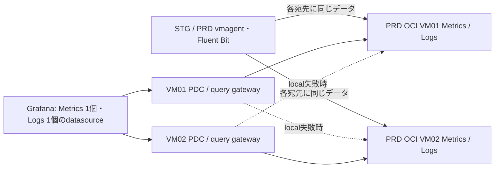

# Re:Venter 監視の移行と運用

現在のPRD URL:
- `http://victoria-metrics-prd.reventer-monitoring.svc.cluster.local:8428`
- `http://victoria-logs-prd.reventer-monitoring.svc.cluster.local:9428`

上図は現在のGrafana経路。ingest endpointはVMごとに分け、
Cloudflare Accessのservice tokenで認証する。共有Tunnelでランダムに片側へ
書き込む構成にはしない。read proxyにはquery APIだけを許可している。

## Grafana切り替え

1. 現在のMetrics/Logs datasource URLとPDC選択を確認する。datasource UIDは
   維持する。標準の`.svc.cluster.local` / `.svc` URLは、各PDC containerの
   `extra_hosts`で同じloopback query gatewayへ解決する。他のURLなら先に
   alias / read route / TLS / PermitRemoteOpenを調整し、実URLで検証する。
2. 全collectorのMetrics pending bytesとFluent Bit backlogが排出され、
   両VMで履歴と新しいデータが読めることを確認する。stale/空のreplicaを
   Grafanaの優先backendへ戻さない。
3. 旧`monitoring/pdc-agent.yaml`をreplicas=0としてGitへ公開し、停止を確認。
   `scripts/deploy-reventer-observability.py --enable-pdc`で2 agentを有効化する。
   同じPDC networkでGrafanaの既存datasource・dashboard・alertを確認する。
4. 実Grafanaから片側停止と復帰を再確認する。停止側の復帰前にqueue/freshnessを
   確認し、必要ならPDCを一時的に除外してcatch-upを待つ。

## バックアップ・復元

元保存先を稼働させたまま公式APIでimmutable snapshotを作成し、
`scripts/snapshot-reventer-observability.py --replica 01`（または02）でstagingする。
Metricsは128MBを目安に分割し、SHA256が一致しないファイルだけ再転送する。
スナップショットの大きな一括転送やBusyBox `tail`による大容量再開には依存しない。
スナップショット名はremote `migration/snapshot-metadata.json`に記録する。
全payloadはTLSとSSHで直接送信し、local workspaceにarchiveを書かない。

新VMの停止中に`restore-reventer-observability.py --replica 01`を使う。
checksum、archive path、停止状態を確認し、初期データは`*-bootstrap`へ退避する。
一度復元されたVMにはmarkerが付くため、この初回seed手順を再実行しない。
`verify-reventer-observability.py`と`backfill-reventer-observability.py`は固定時刻を検証・補完する移行用scriptであり、日常のbackup手順ではない。

VMのdisk消失やqueue上限を超えた長期停止からの復旧では、生存replicaの新しい
snapshotで履歴を再seedする。queueだけでは古い履歴は復元できない。
検証後に作成したsnapshotだけを公式delete APIで整理できる。元保存先や
復元済みdata、PVCの削除とは分け、復旧可能なbackupを維持する。

## 容量・認証・監視

- STG割当200GB（100GB boot × 2）、PRD割当194GB（47GB boot × 2 + 50GB boot × 2）。
  両環境ともvolumeは10 VPU/GB、OKEはBasic。PRD volume backupは2個/無料5個枠。
  公式文書のA1無料条件と既存契約の適用は
  区別し、明細を監視する。共有バックアップのObject Storageリクエスト課金は別途確認。
  OKE node交換・burst・残ったboot volumeも全て集計してから変更する。
- 各VMは1GB RAM / 50GB boot。query concurrency=2とメモリ上限を使い、
  Docker log rotation / swap / security updatesを設定。swapを常用してよい
  設計とはしない。disksの20%以上を空け、query/merge時の余裕を監視する。
- Always Freeのidle reclamationや同一tenancy/ADの障害は、この2 VMの片側障害
  対策だけでは保証できない。人工的な負荷で回収判定を回避せず、状態を監視し
  復旧可能なbackupを持つ。
- Metrics queueは各URL 2GiB。STG/PRDとも専用hostPath `/var/lib/reventer/vmagent` に保持する。
  node disk消失ではqueueも失われるため、失われた期間は生存replicaから復旧する。
  hostPathはPod再起動には残るが、node/disk消失には残らない。
- Logsは各output 256MBのfilesystem queue、無制限retry、jitter付き3〜30秒の
  再試行。deliveryはat least onceであり、再送時に重複logが生じ得る。
  上限を超えると古いデータが捨てられるため、queueとdrop counterを監視する。
- `up{job="oci-monitoring-storage"}`、process memory、free disk、
  `vmagent_remotewrite_pending_data_bytes` / `vmagent_remotewrite_packets_dropped_total`、
  Fluent Bitのstorage/backlog/drop/retry統計を確認する。
  Grafanaのalertルール変更はまだ行っていない。切替時に既存alertも検証する。
- Cloudflare credentialsはHCPの暗号化remote state管理、collector Secretは
  Terraform管理。Access service tokenは1年の有効期間を持つため期限前に更新。
  secretをrotationしたらcollectorを再起動し、VM `.env` / gatewayも再deployする。
  Bitwarden controllerのcredentialを抽出する方法は使わない。
- Bootstrap `user_data`変更はOCIでVM再作成を要求する。既存VMは`prevent_destroy`
  と`ignore_changes`で保護し、Docker Compose v2やbundleの更新はguest内で行う。
  boot volumeの保持も有効。日常の設定更新でVMを作り直さない。

## OS更新

日次の順次更新、実収集canary、boot backupによるrollbackは
[os-update/README.md](os-update/README.md)を参照。
独立したsecurity updateは協調制御へ移し、両VMの同時更新を防ぐ。
