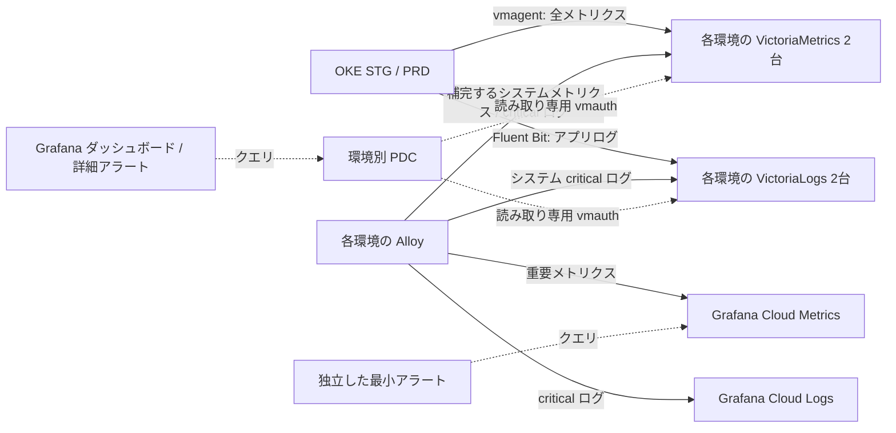

# Re:Venter Grafana の PDC とアラート

## 構成

メトリクスと通常ログの一次保存先は各環境の VictoriaMetrics / VictoriaLogs
2台。Alloy は重要メトリクスと critical ログだけを Grafana Cloud に複製する。
PDC は Grafana のクエリを VM に中継する経路であり、remote_write の送信経路ではない。



`terraform/grafana-cloud/reventer-catalog.json` は接続先 UID、環境別 PDC ネットワーク ID、移行先アラート式と
旧 Integration ルールの識別情報を持つ。トークン、パスワード、ログ本文は含まない。
`scripts/reconcile-reventer-grafana.py` がこのカタログの範囲だけを管理する。

| 環境 | Metrics UID | Logs UID | PDC network ID |
| --- | --- | --- | --- |
| STG | cg0m1h98bpedcb | dg0m1l2fyeuioa | e6b28cc2-b9f8-489f-ac33-29d3e5b335d1 |
| PRD | cfp1pqo5zixa8e | bfp1q8yd3n85cf | b24ae1c9-8cd8-4312-addd-96086f1038b9 |

## PDC 502 の原因と修復

4データソースが旧共有ネットワーク `093e5c07-2a7e-4549-a6a3-015f421911b3` を
指定していたが、VM 上の PDC は既に環境別トークンで正常接続していた。
4台すべてのエージェントの公開 SSH 証明書 Key ID と環境別 BSM トークンの一致を
確認し、データソースの `jsonData.secureSocksProxyUsername` だけを上表の ID に更新した。
UID、URL、認証情報、クエリ設定、ダッシュボード参照は維持する。
VM の再起動、ストレージの再作成、トークン再発行は不要だった。

公開証明書の確認（秘密鍵を読まない）:

```sh
sudo docker exec reventer-observability-pdc-1 \
  ssh-keygen -L -f /home/pdc/.ssh/grafana_pdc-cert.pub
```

`1121307/<network ID>` の Key ID が、その VM の所属環境と一致すること。
SSH 接続は OCI API で VM と IP の対応を検証してからホスト鍵を登録し、以後照合する。
将来 PDC access policy を再作成した場合は、トークンだけでなくカタログ内の network ID
も対応させる。ホストやポートの推測で別環境のネットワークに接続しない。

## アラート移行

旧 Integration の124ルール（記録69、アラート55）は削除せず停止する。
元の式・ラベル・通知設定は Grafana 上に残す。旧ルールの UID と内容の fingerprint を
確認し、想定外の編集がある場合は自動移行を中止する。
旧ルールは `converted_prometheus` 管理のため、従来 provisioning PUT は409になる。
Cloud namespace `stacks-1121307` の App Platform API に対して
`metadata.resourceVersion` を test し `spec.paused` のみ JSON Patch することで、
管理区分と内容を維持する。クエリ配列の順序は新 API が refId 順に正規化するため、
fingerprint も refId 順で照合する。記録ルールの旧 API における condition / error state は
App Platform 側で空に正規化されるが、実行に用いる `record.from` と式は変えない。

各環境41ルール、合計82ルールを別フォルダに作成する:

- Cloud 7 / 環境: CrashLoop、Node Ready / Pressure / Unreachable / Readiness Flapping、
  Alloy テレメトリー欠落、重要 exporter 停止・欠落。PDC 障害から独立して評価する。
- 一次保存先34 / 環境: Pod / Deployment / StatefulSet / DaemonSet / CPU / Memory /
  Kubelet / ストレージ等の詳細33ルールと、収集ジョブ停止・欠落1ルール。
  各環境の VictoriaMetrics を PDC 経由で評価し、Cloud に全メトリクスを戻さない。

旧55アラートのうち38テンプレートを継承する。残り17は未対応として停止する:

- API SLO 4 + API server 5: OKE 管理コントロールプレーンの対象メトリクスを未収集。
- Job 2 / HPA 2 / PDB 1 / ResourceQuota 3: 現在の kube-state-metrics の
  `--resources` にこれらの対象がない。

PVC / PV は KSM の収集対象に含まれるため、現在リソースがない場合もルールを残す。
旧69記録式を参照するダッシュボードは調査対象31件にはなかった。
継承アラートに必要な3式だけをインライン化し、新しい記録系列は生成しない。

修正した意味:

- CPU / Memory Overcommit: OKE で非公開の `control-plane` ノード数による分岐を外し、
  稼働 Pod の要求合計から取得可能な worker の allocatable 合計を引き、超過量が正の場合を判定する。
  N-1 の冗長余裕の判定ではない。
- Kubelet PLEG p99: 既存の histogram_quantile 記録式を直接評価する。
- PromQL の比較結果は値が0でも障害系列の場合がある。旧変換の「結果系列が存在する」
  という判定を維持し、`$query > 0` に置き換えない。
- 通常の条件不成立による NoData は OK、実行エラーは Error。
  欠落を検知すべき収集ジョブは専用 absent_over_time ルールで監視する。
- 通知文の Prometheus `$value` は Grafana の `$values.query.Value` に変換し、
  真偽判定の1ではなく実測値を表示する。
- 通知は既存の severity 別 Discord contact point を指定し、通知先や webhook は変更しない。

## 適用・検証・復元

認証は既存の `GRAFANA_URL` / `GRAFANA_AUTH` または BSM を使用する。
読み取り専用の `plan` と `check` は設定を書き換えない。
`stage` は移行先を停止状態で作成し、既存ルールを停止しない。
`apply` は PDC の環境分離と全82クエリを検証し、移行先を有効化して読み戻した後に
旧ルールを停止する。途中失敗時は再実行できる。未知の同居ルールを group PUT で消さない。

```sh
python3 scripts/test-reventer-grafana.py
python3 scripts/reconcile-reventer-grafana.py plan
python3 scripts/reconcile-reventer-grafana.py stage
python3 scripts/reconcile-reventer-grafana.py apply
python3 scripts/reconcile-reventer-grafana.py check
# 手動ロールバック: 旧世代を先に復元し、新世代を停止する
python3 scripts/reconcile-reventer-grafana.py restore-legacy
```

バックアップは既定で `terraform/grafana-cloud/.state/reventer-backup/` に0600で保存する。
Git に追加しない。ロールバック後の `apply` は再び新世代へ移行する。
自動適用を恒久停止する場合は、Terraform の provisioner と deployment check も
合わせて見直す。削除操作や destroy provisioner はない。

Terraform の `terraform_data.reventer_observability` が catalog / updater のハッシュを
追跡し、既存 main CI の apply で反映する。毎回の deploy 最終チェックでも API の実態を
照合するため、手動の pause、式や接続先の drift は検出される。
カタログは既存 workflow の監視パス `terraform/grafana-cloud/**` 内に配置し、
カタログのみの更新でも CI を起動する。

検証クエリ（Metrics は対応環境のデータソースで実行）:

```promql
vector(1)
count by (env, cluster) (up)
count by (job) ({__name__!=""})
```

Logs では直近1時間の `* | stats by (env) count() as lines` を評価し、
STG / PRD の混在がないことを確認する。ログ本文を出力しない。
Cloud 側では次を確認する:

```promql
count by (env, cluster, job) (up)
grafanacloud_instance_active_series
```

Active Series は課金集計の時間窓を持つため、瞬間の系列数と一致しない。
最小運用の目安は通常3,000未満、5,000を超えたら収集追加とカーディナリティを再点検する。
重要ログの二重保存経路と自前ストレージの保持は、このアラート移行では変更しない。

## 適用時の確認記録（2026-10-25 JST）

- STG / PRD の Metrics / Logs 全4接続で PDC 経由 HTTP 200。
  `count by(env,cluster)(up)` と Logs の環境別件数で混在なし。
- 新82ルールが有効、Grafana 評価状態 API で82件すべて `health=ok`、実行エラーなし。
  Cloud 14件 / 一次保存先68件。旧124件は全停止、削除なし。
- 自宅フォルダの既存282ルールは切り替え前の取得内容と完全一致。
- Cloud usage の Active Series は1,439（上限10,000の約14%）。
  Cloud の収集対象追加やメトリクスの一次保存先変更は実施していない。
- CPUThrottlingHigh の条件に STG / PRD それぞれ4系列が一致。
  これは詳細監視の復旧により見える CPU 制限・負荷の問題であり、PDC の実行エラーではない。
  閾値を緩和して隠さず、継承した警告条件を維持している。
- Terraform mock 9ケース、更新処理の安全性テスト、既存282アラートの
  PromQL 検証と107の動作ケースが成功。

関連する公式仕様:
[PDC 設定](https://grafana.com/docs/grafana-cloud/observe-and-act/connect-externally-hosted/private-data-source-connect/configure-pdc/)、
[Grafana Alerting API](https://grafana.com/docs/grafana-cloud/observe-and-act/alert-and-measure-reliability/alerting/set-up/provision-alerting-resources/http-api-provisioning/)。
